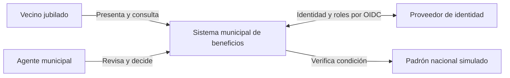
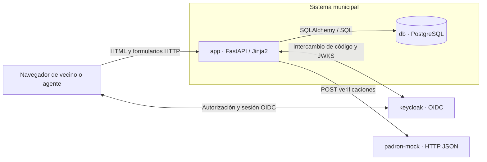
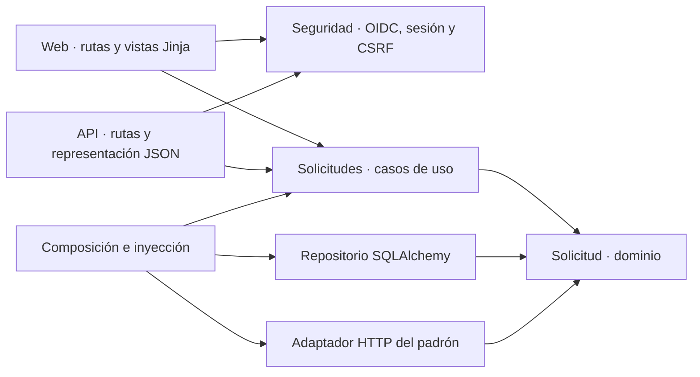

# Arquitectura del corte 7A

**Integrantes** Facundo Cichero y Ezequiel Pereira.

Un municipio atiende a unas 3.000 personas, con dos beneficios, un canal web, un servidor y dos desarrolladores. El diseño cubre el trámite municipal y sus dependencias. La demo implementa login, presentación, decisión y consulta del resultado, con identidades y padrón ficticios. El objetivo prioritario es que una persona jubilada pueda completar el trámite con un celular antiguo y una conexión lenta.

## Decisión de estilo y límites

La clase 1 distingue decisiones que condicionan calidad, alcance y costo de cambio. Aplicamos ese criterio al despliegue, la UI, el almacenamiento, la frontera del padrón y la identidad. La comparación de la clase 2 se conserva con el monolito en capas como referencia y signos relativos.

| Criterio | Capas | Modular | SOA |
| --- | ---: | ---: | ---: |
| Operación en un servidor | 0 | 0 | −1 |
| Cambio y prueba de reglas | 0 | +1 | −1 |
| Límites del dominio | 0 | +1 | 0 |
| Comunicación interna | 0 | 0 | −1 |
| Escalado útil en este escenario | 0 | 0 | 0 |
| Total relativo | 0 | +2 | −3 |

Los puntos del modular dependen de mantener límites comprobables. Un solo despliegue simplifica la operación y obliga a publicar y escalar el núcleo como una unidad. Con un servidor y dos desarrolladores, una cola, SOA o microservicios añadirían procesos, manejo de fallas distribuidas y estados intermedios sin resolver una necesidad del corte. El agente necesita la respuesta del padrón antes de aprobar y puede reintentar si falla. Aplicamos sincronismo para esa decisión acotada, con timeout y resultado explícito (clases 6 y 7).

## C4

### Contexto

### Contenedores

Los cuatro servicios de ejecución comparten la red interna de Compose. `app` y `keycloak` publican en loopback, en 8080 y 8180. `db` conserva `pgdata` y tiene un healthcheck `pg_isready`. `keycloak` conserva su base local H2 en `kcdata`. `keycloak-data-init` ajusta los permisos del volumen y termina como paso de arranque. Compose espera que PostgreSQL esté disponible y que arranquen Keycloak y el mock. La verificación HTTP confirma que estos dos últimos ya atienden peticiones. El Dockerfile construye una única aplicación Python con su API y vistas, instala dependencias del directorio `vendor` y arranca Uvicorn (clase 10).

### Componentes dentro de `app`

`main.py` registra routers, middleware, plantillas estáticas y manejadores. `dependencias.py` conecta los casos de uso con el repositorio y el padrón. `solicitudes/servicio.py` solo depende del dominio y de la biblioteca estándar. Define el contrato `RepositorioSolicitudes` y recibe una función que devuelve el resultado de verificación. `solicitudes/dominio.py` usa solo la biblioteca estándar. `solicitudes/repositorio.py` conserva la tabla existente y traduce filas a entidades. `integraciones/padron.py` traduce valores externos y fallas HTTP al vocabulario interno. Las rutas llaman al servicio y las vistas presentan datos; esta separación MVC acompaña a una MPA con HTML renderizado en servidor (clases 3 a 5).

El test `tests/test_architecture.py` analiza imports con `ast`. Impide acceso directo desde rutas al ORM y a los clientes externos, dependencias de infraestructura en dominio y aplicación, y ciclos entre los módulos enumerados. Al crear un módulo se revisa explícitamente su lugar en el mapa.

## Dominio, transacciones e identidad

- **Solicitud** es la entidad raíz del agregado del corte. Identifica al dueño y guarda el beneficio, las fechas, el estado, el motivo y el agente. El catálogo fijo identifica los dos beneficios y permanece junto al módulo que lo usa. No hay historial separado de consultas al padrón.
- El servicio exige `vecino` al presentar y `agente` al listar pendientes o decidir. La entidad nace pendiente, acepta una sola decisión válida y solo aprueba con resultado positivo. El vecino consulta sus propias solicitudes. La aplicación deriva la identidad de la sesión o del JWT verificado, y vincula al padrón en el servidor.
- El adaptador convierte `jubilado` y `pensionado` en elegible. `no_registrado` es una negativa válida y se comunica con `409`; el agente puede rechazar con motivo. Timeout, error HTTP o respuesta inválida producen `503` y conservan la solicitud pendiente. HTTPX tiene configurados 3 s de timeout por fase, sin reintentos automáticos. Ese valor no es una garantía de latencia total.
- PostgreSQL arbitra decisiones concurrentes mediante `UPDATE ... WHERE id = ... AND estado = 'pendiente' RETURNING ...`. La consulta al padrón ocurre antes del `UPDATE`. Si ya ganó otra decisión, el cambio afecta cero filas y el agente recibe `409`. No se toma un bloqueo de escritura mientras responde el padrón. Dos intentos simultáneos de aprobación pueden consultar dos veces el padrón.

| Operación | Público | Vecino | Agente |
| --- | --- | --- | --- |
| Catálogo | Sí | Sí | Sí |
| Presentar | Requiere login | Sí | No |
| Consultar detalle | Requiere login | Solo propio | Sí |
| Listar pendientes y decidir | Requiere login | No | Sí |

Keycloak autentica por Authorization Code con PKCE S256. La aplicación verifica `state`, firma RS256 por JWKS, emisor, audiencia y vigencia del JWT. La API usa Bearer; la web usa cookie de sesión firmada `SameSite=Lax` y token CSRF en formularios. El logout elimina la sesión local y solicita el fin de sesión OIDC con una pista cifrada en la cookie. La API implementa REST nivel 2 con recursos, verbos y códigos HTTP, contrato OpenAPI versionado en `/api/v1`, `Location` al crear y Problem Details para errores JSON. La navegación web presenta errores HTML accesibles (clases 9 y 11).

Las defensas de la demo incluyen puertos locales, DB y padrón internos, credenciales fuera del repositorio y configuración por entorno. El HTTP local, `start-dev`, la cuenta inicial de PostgreSQL con privilegios de administración y los procesos Python como root delimitan la demo. Para producción quedarían TLS, endurecimiento del IdP, privilegios mínimos, gestión y rotación de secretos, respaldo y restauración ensayados, y observabilidad sin datos personales. La revisión actual conserva la configuración de ejecución (clase 12).

## Escenarios de calidad y evidencias

La escala del árbol de utilidad es alta, media o baja para **importancia, dificultad**, en ese orden. Accesibilidad y usabilidad → Q1 (alta, alta). Rendimiento móvil → Q2 (alta, alta). Resiliencia → Q3 (alta, media). Autorización → Q4 (alta, media). Mantenibilidad → Q5 (alta, media). Los objetivos son criterios de aceptación del grupo para el corte, con WCAG AA como exigencia del escenario.

| Escenario | Fuente y estímulo | Artefacto y entorno | Respuesta esperada | Medida objetivo |
| --- | --- | --- | --- | --- |
| Q1 Accesibilidad | Vecino con baja visión y agente operan con teclado o ayuda técnica. | Portal y Keycloak, escritorio, 320 y 360 px, y zoom real al 200 % en escritorio. | Completar el trámite con foco visible, orden lógico, labels y estados textuales. | 0 bloqueos de teclado o reflujo horizontal en el recorrido y 0 infracciones axe de las reglas ejecutadas. Validar significado de controles, errores y estados con ayuda técnica real. |
| Q2 Red lenta | Vecino abre la portada, inicia sesión y presenta una solicitud con caché fría. | Chrome emulado a 360 px, 400 kbps por sentido, 200 ms de latencia, sin limitación de CPU. | Vistas utilizables y recursos locales. | Como presupuesto del prototipo, mediana de 3 corridas ≤ 50 KiB de cuerpos codificados y ≤ 4 s desde la acción a carga por vista. Evaluar después en un teléfono real. |
| Q3 Padrón y concurrencia | Agente aprueba con timeout, error, respuesta inválida o negativa. Dos peticiones compiten por una misma solicitud. | Adaptador, servicio, API y PostgreSQL en Compose, con inyección de fallas HTTP en pruebas aisladas. | Falla técnica preserva pendiente. Negativa conserva pendiente con explicación. La carrera conserva la primera decisión persistida. | `503` técnico, `409` negativo, cero aprobaciones incorrectas. Para la carrera, exactamente un `200` y un `409`, con estado, motivo y fecha de la respuesta ganadora. |
| Q4 Autorización | Anónimo o vecino intenta acceso protegido, ajeno o de otro rol. | API REST y formularios web con Keycloak en Compose. | Denegar por autenticación, rol, dueño o CSRF, y permitir las acciones propias. | `401` sin credencial válida, `403` por rol, dueño o CSRF según el caso, y el circuito legítimo concluye. |
| Q5 Mantenibilidad | Un desarrollador cambia reglas o introduce una dependencia hacia afuera. | Módulos Python y prueba estática de imports. | Las reglas pueden probarse sin infraestructura y las dependencias apuntan hacia adentro. | 0 imports prohibidos. El test falla ante un acoplamiento prohibido y corre con el resto de las pruebas aisladas. |

### Evidencia observada

Antes del cambio pasaron 8 pruebas aisladas, 123 verificaciones HTTP y 53 vistas auditadas con axe. Después pasaron 10 pruebas aisladas, 131 verificaciones HTTP, 53 vistas sin infracciones de axe y 14 recorridos de teclado. La cantidad HTTP incluye una validación por cada solicitud pendiente listada, por lo que varía con los datos de prueba. Zoom real al 200 % en seis pantallas. Se recrearon los cuatro servicios conservando volúmenes. El mismo vecino recuperó una solicitud aprobada. La carrera en PostgreSQL produjo un 200 y un 409, y se conservó la decisión ganadora. La regresión del navegador incluye logout en Keycloak y cambio de cuenta sin borrar cookies.

Chrome 157.0.8103.51, tres corridas en la demo local. Los bytes corresponden al cuerpo codificado del documento final y sus recursos. El tiempo incluye la acción, los desvíos de OIDC cuando corresponden y la instrumentación.

| Vista | Cuerpo codificado (B) | Acción a carga (ms) |
| --- | ---: | ---: |
| Portada | 11634 | 700 |
| Login Keycloak | 21392 | 1187 |
| Inicio vecino | 106547 | 3014 |
| Detalle después del alta | 11865 | 1002 |

Las cuatro vistas alcanzaron el objetivo de tiempo. El inicio del vecino superó el presupuesto de peso. El inicio del vecino mostró entre 78 y 80 tarjetas de solicitudes de prueba. La lista completa aumenta el HTML al crecer el historial. La paginación queda como trabajo posterior. Los procedimientos reproducibles están en `tests/smoke_compose.py`, `tests/test_architecture.py`, `tests/test_concurrency.py` y `tests/accesibilidad/`.

La demo no se sometió a una prueba de capacidad para 3.000 usuarios concurrentes. Tres corridas locales respaldan una medición acotada y no un percentil de producción. Quedan pendientes la evaluación completa con lector de pantalla y un teléfono antiguo real, y el ensayo con usuarios representativos. La evaluación automática y de teclado cubre una parte de POUR y WCAG 2.2 AA.

### Riesgos y puntos de sensibilidad

| Escenario | Hallazgo | Tratamiento |
| --- | --- | --- |
| Q1 | El tema de Keycloak y los mensajes de error son parte del recorrido. Axe puede omitir problemas de lectura u orden de anuncios. | Auditoría del login y del portal, más prueba manual pendiente con lector y dispositivo real. |
| Q2 | El peso inicial del login y el tiempo de ida y vuelta a Keycloak dominan el costo en red lenta. La MPA vuelve a descargar HTML al navegar. | CSS liviano, presupuesto reproducible y medición con caché deshabilitada. |
| Q3 | El tiempo de respuesta depende del padrón. Una doble decisión puede intentar verificar dos veces. | Timeout por fase, sin reintentos automáticos, y escritura condicional atómica. |
| Q4 | La disponibilidad del IdP condiciona el login. HTTP y secretos locales se limitan al entorno de demo. | Validación de JWT y propiedad, pruebas de roles y CSRF. Endurecer el despliegue antes de producción. |
| Q5 | La modularidad tiene costo de separación y el catálogo fijo cambiará junto con la aplicación. | Prueba de dependencias y extraer un módulo de catálogo si aparecen reglas propias o administración de beneficios. |

## Revisión de los seis ADR

Las decisiones aceptadas conservan su intención original. La actualización registra qué quedó implementado y cómo verificarlo (clase 13).

| ADR | Contexto y decisión | Alternativas reales | Consecuencias y NFR | Confirmación |
| --- | --- | --- | --- | --- |
| 001 Monolito modular | Un servidor y dos desarrolladores. Solicitudes agrupa reglas, servicio y adaptadores en un despliegue. | Monolito en capas o SOA. | Menor operación y mejor aislamiento de reglas, con disciplina de límites y despliegue conjunto. Q5. | Implementado. Pugh, código, test de arquitectura y Compose. |
| 002 MPA | Clientes antiguos y red lenta. HTML/Jinja renderizado en servidor por solicitud. | SPA con carga inicial y navegación en cliente. | Menos lógica cliente y foco nativo, con recargas de HTML. Q1 y Q2. | Axe, teclado, reflujo, zoom y medición de red. Pendiente prueba manual completa. |
| 003 Persistencia | Estado durable y decisión consistente. PostgreSQL con volumen y una escritura condicional. | Base documental o archivo local. | Consistencia y consultas conocidas, a cambio de operar y respaldar la base. Q3 y Q5. | Volúmenes conservados, regresa la solicitud aprobada y la prueba concurrente preserva la ganadora. |
| 004 Padrón síncrono | Aprobación exige una respuesta en el momento. Adaptador síncrono con timeout. | Flujo diferido por cola y estados adicionales. | Resultado inmediato y vocabulario interno estable, con dependencia temporal del padrón. Q3. | Casos positivo, negativo, timeout, respuesta malformada y 503. |
| 005 Autorización | Separar identidades y permisos sin almacenar contraseñas en el núcleo. OIDC, PKCE, roles y propiedad. | Identidad propia o validación centralizada en un gateway. | Frontera de identidad explícita, con dependencia de Keycloak y configuración adicional. Q1 y Q4. | 401, 403, CSRF, cambio de cuenta y logout en el mismo navegador. |
| 006 Tecnología | Un comando local, API y web en el mismo despliegue. Python/FastAPI, PostgreSQL, Keycloak y Compose. | Framework web integrado o despliegues separados de SPA y API. | Reproducción sencilla y contrato independiente del framework, con mantenimiento de dependencias y entorno OIDC. Q2, Q4 y Q5. | `compose config --quiet`, `compose up -d --build`, estado de servicios y pruebas de `docs/openapi.yaml`. |

## Referencias del TP

Arquitectura de Software 1, UNAHUR 2026, clases originales 1–7 y 9–13. Clase 2, C4 y Pugh. Clase 3, DDD y regla de dependencia, láminas 17–25. Clase 4, ACL, lámina 8, y persistencia. Clase 5, MVC, MPA y POUR. Clases 6–7, mecanismos de integración y estilos. Clase 9, consigna, REST y contrato. Clases 10–12, Compose, OIDC y defensa en profundidad. Clase 13, láminas 5–7, 20–21 y 24–32, escenarios, fitness functions, ADR y entrega. Planilla del TP, hoja 7A y asignación fila 23. Documento de arquitectura del equipo, secciones 7–21.

Para la defensa, mostrar primero el C4 de Contenedores y la diferencia entre desplegar el núcleo y consumir servicios externos. Recorrer vecino → agente → vecino con teclado, incluida la salida entre roles. Mostrar el caso de padrón caído y explicar por qué 503 deja pendiente, cómo se evita una doble decisión y qué detecta la prueba de arquitectura. Cerrar con las medidas de red y los límites de la evidencia de accesibilidad.
